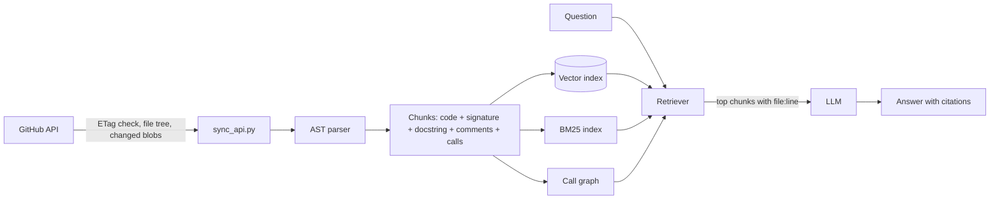

# 🦆 RubberDuck.ai

**Code-aware RAG for software development.** Point it at a GitHub repository and ask questions, get suggested changes, or generate documentation. Every answer cites the exact file and line range it came from.

Most RAG tools split code into fixed-size text windows, which cuts functions in half and loses structure. RubberDuck.ai parses code into its **AST**, combines that structure with the natural language around it (docstrings and comments), and retrieves with a hybrid of semantic search, keyword search and a call graph.

## Features

- **AST-based chunking:** each function, method, class and module becomes one chunk, with its signature, docstring, comments, imports and the functions it calls.
- **Hybrid retrieval:** vector search and BM25 (with identifier splitting, so `getUserName` matches "user name") are merged with reciprocal-rank fusion.
- **Call-graph expansion:** the callers and callees of the best hits are pulled in, so answers include the surrounding code and not only the matching function.
- **Exact symbol lookup:** asking for `Command.invoke` returns that symbol, not something merely similar.
- **Three modes:** `ask` (questions), `suggest` (proposed code changes), `document` (docstrings and usage docs).
- **Clone-free GitHub sync:** it fetches files through the GitHub API, using ETags and blob SHAs to re-embed only what changed. Nothing is cloned to disk.
- **Three ways to use it:** CLI, web UI and REST API.
- **Any OpenAI-compatible LLM:** works with Groq, xAI Grok, OpenAI and others.

## How it works



1. **Sync.** One conditional request (ETag) asks whether the repo changed. If so, one request fetches the full file tree with each file's SHA, which is a hash of its content. Only files whose SHA differs from the stored one are downloaded, parsed and embedded. A first index of many files uses a single in-memory tarball, and deleted files are removed from the index.
2. **Parse.** Python's `ast` module turns each file into chunks. Each chunk records the names it calls, and those become edges in the call graph.
3. **Index.** The text of each chunk (what it is, its docstring and comments, then its code) is embedded into Chroma and also indexed with BM25.
4. **Retrieve.** Semantic and keyword rankings are fused, exact symbol matches are promoted, and call-graph neighbours are added.
5. **Generate.** The retrieved chunks go to the LLM with instructions to cite sources, stay within the code shown and follow the repo's conventions.

## Quick start

Requires Python 3.10+, and [uv](https://docs.astral.sh/uv/) is recommended.

```bash
git clone https://github.com/YOUR-USERNAME/rubberduck-ai.git
cd rubberduck-ai
uv venv --python 3.12
```

Activate the environment:

```bash
source .venv/bin/activate          # macOS / Linux
.venv\Scripts\Activate.ps1         # Windows PowerShell
```

Install dependencies (the first install is large because of PyTorch). On a machine without a GPU, installing the CPU build first is much smaller:

```bash
uv pip install torch --index-url https://download.pytorch.org/whl/cpu
uv pip install -r requirements.txt
```

Set your keys. In PowerShell use `$env:NAME="value"` instead of `export`:

```bash
export XAI_API_KEY="your-llm-provider-key"
export LLM_MODEL="openai/gpt-oss-120b"
export GITHUB_TOKEN="github_pat_..."      # strongly recommended, see below
```

Run the web UI:

```bash
uvicorn rubberduck.server:app --port 8000
```

Open <http://localhost:8000>, type a repo such as `pallets/click`, click **Index repo**, then ask a question. The first index takes a few minutes on CPU, and later syncs only process changed files.

## Usage

### Web UI

The page at `/` has an **Index repo** button and Ask, Suggest and Document tabs. Suggest accepts an optional code snippet to modify.

### CLI

```bash
python -m rubberduck index    pallets/click
python -m rubberduck ask      pallets/click "How does Click parse command line options?"
python -m rubberduck suggest  pallets/click "in decorators.py, make group() add a --verbose flag"
python -m rubberduck document pallets/click "Command.invoke"
```

### REST API

| Endpoint | Method | Body or params | Purpose |
|---|---|---|---|
| `/index?repo=owner/name` | POST | none | Sync and index a repo |
| `/ask` | POST | `{repo, query, code?, k?}` | Answer a question |
| `/suggest` | POST | `{repo, query, code?, k?}` | Propose a change |
| `/document` | POST | `{repo, query, k?}` | Generate documentation |
| `/webhook/github` | POST | GitHub push payload | Re-sync on push |

Interactive API docs are at <http://localhost:8000/docs>.

## Configuration

| Variable | Default | Purpose |
|---|---|---|
| `XAI_API_KEY` | none | API key for your LLM provider. The name is historical, and it is used for any OpenAI-compatible provider. |
| `LLM_MODEL` | `grok-4.3` | Chat model ID. Use one your provider offers. |
| `GITHUB_TOKEN` | none | Raises the GitHub rate limit from 60 to 5,000 requests per hour and allows private repos. |
| `GITHUB_WEBHOOK_SECRET` | none | Verifies webhook signatures. |
| `EMBED_MODEL` | `BAAI/bge-small-en-v1.5` | Embedding model. A smaller option is `sentence-transformers/all-MiniLM-L6-v2`. |
| `RUBBERDUCK_DATA` | `.rubberduck` | Where the index and sync state are stored. |

**Choosing an LLM provider.** The provider endpoint is set by `base_url` in `rubberduck/generate.py`:

```python
client = OpenAI(api_key=XAI_API_KEY, base_url="https://api.groq.com/openai/v1")   # Groq
# base_url="https://api.x.ai/v1"      # xAI Grok
# base_url="https://api.openai.com/v1"  # OpenAI
```

If you change `EMBED_MODEL`, delete `.rubberduck/chroma` and re-index, because embeddings from different models can't be mixed.

### Creating a GitHub token

GitHub → Settings → Developer settings → Personal access tokens → Fine-grained tokens → Generate. Set **Contents: Read-only**, and choose public repositories, or select your private repos. Never commit a token.

## Live updates with webhooks

To re-sync automatically on every push, add a webhook to the target repo with the payload URL `https://YOUR-HOST/webhook/github`, content type `application/json`, the **push** event, and the same secret as `GITHUB_WEBHOOK_SECRET`. GitHub must be able to reach your server, so use a public host or a tunnel such as ngrok. Without webhooks, click **Index repo** again to pull the latest commits.

## Project structure

```
rubberduck/
├── config.py        settings and environment variables
├── models.py        Chunk dataclass and the text used for embedding
├── ast_parser.py    AST to chunks (register new languages in PARSERS)
├── text.py          identifier-splitting tokenizer for BM25
├── graph.py         caller to callee graph
├── index.py         Chroma vectors, BM25 and graph in one Index
├── retrieve.py      exact match, RRF fusion and graph expansion
├── generate.py      prompts and LLM call (ask, suggest, document)
├── sync_api.py      clone-free GitHub sync using ETag and SHA (default)
├── sync.py          alternative sync using git clone
├── server.py        FastAPI app, web UI route and webhook
├── __main__.py      CLI
└── static/index.html  web UI
tests/
└── test_parser.py
```

## Tests

```bash
uv pip install pytest
python -m pytest tests
```

## Limitations

- **Python only for now.** Other languages need a parser registered in `ast_parser.PARSERS`.
- **Suggestions are drafts.** The model can't run your code, so a suggested diff may look right and still fail. Review it, and run the repo's tests before applying it.
- **Answers can reflect test files.** Tests are indexed alongside source, which is helpful for usage examples but can sometimes crowd out implementation code.
- **Call resolution is by name.** Two functions with the same name in different modules can be linked incorrectly.
- **Code chunks are sent to your LLM provider** with each request. Don't index confidential code with a provider you don't trust.
- **No authentication** on the API yet, so don't expose it publicly as is.

## Deployment notes

Run it on a host with a persistent disk (a VPS, or Render, Railway or Fly.io with a volume) and point `RUBBERDUCK_DATA` at that volume. Serverless platforms don't fit, because indexing takes minutes and PyTorch is large. Before exposing it publicly, add authentication, move indexing into a background job, and run a single worker, since indexes are cached in process memory.

## Roadmap

- [ ] Run the repo's tests against suggested changes
- [ ] JavaScript and TypeScript support through tree-sitter
- [ ] Type-aware call resolution using imports
- [ ] Background indexing with progress reporting
- [ ] API key authentication
- [ ] Retrieval evaluation set to measure hit rate

## License

Add a license file before publishing, such as MIT.